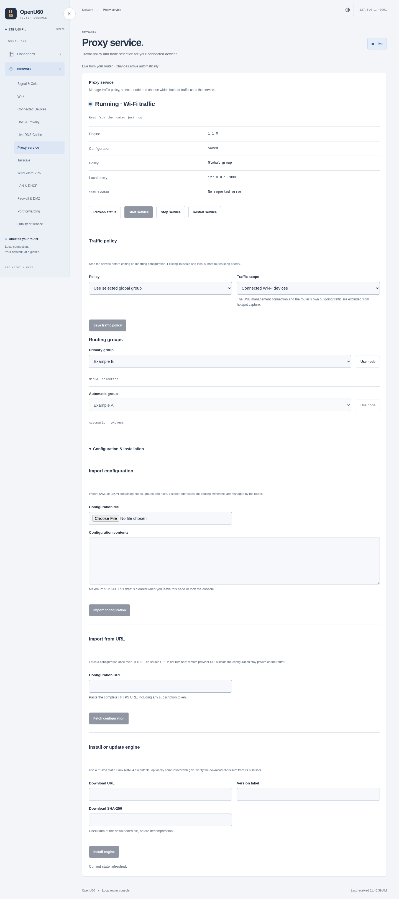

# 网络服务管理

本 fork 的 Web 管理页提供 **Network → Proxy service** 和 **Network → Tailscale**，地址分别为 `/console/#network/proxy`、`/console/#network/tailscale`。需要运行包含这些页面的 fork 版后台；原厂 Web 管理程序与旧版后台不会自动增加入口。

机身的网络分类增加「代理服务」和「代理节点」，与 Web 共用 API、配置和实际运行状态。大段配置导入、订阅下载和内核安装在 Web 完成。

## 代理服务

1. 打开 Web 管理页并登录，在 **Configuration & installation** 中安装内核。填写可信发行文件的 HTTPS 地址、版本标签与下载文件的 SHA-256。文件必须是静态 Linux ARM64 可执行程序，支持单文件 gzip 压缩；校验值对应下载文件本身。
2. 上传或粘贴 YAML / JSON 配置，也可以从 HTTPS URL 下载一次。配置上限 512 KiB；校验成功才替换旧配置。导入和更新时服务须停止。
3. 在 **Traffic policy** 选择分流策略与范围。`Follow rules` 使用配置规则，`Use selected global group` 使用全局选择组，`Direct connections` 直接连接。
4. 范围默认 **Router-local applications only**，本机程序可使用 `127.0.0.1:7890` 的 HTTP / SOCKS 代理。要让连接 Wi-Fi 的设备使用代理，选择 **Connected Wi-Fi devices**，保存，再点击 **Start service**。
5. 启动后，在 **Routing groups** 选择手动组中的节点。自动选择组显示当前节点，按配置自行选择。

启用状态会保存，后台下次启动时尝试恢复。停止、内核退出或所属后台进程消失时，独立清理进程撤销本服务的转发规则；热点恢复普通直连。需要始终阻止直连的场景，目前不适用这一恢复策略。

订阅 URL 仅用于本次下载，不保存到设置，也不自动定时更新。配置中的远端 provider 可按其更新周期自行刷新。浏览器离开页面或锁定时清空草稿、认证密钥和授权链接；界面不读回完整代理配置。

导入保留节点、路由组、规则、远端 provider 与 hosts 数据；端口、控制凭据、DNS、TUN 与流量接管由服务统一生成。当前不接受脚本、文件型 provider 或指向本地私钥文件的配置。远端 provider 必须使用 HTTPS，其缓存路径被限定在服务目录。依赖外部规则数据的配置仍需相应资源可下载。

## Tailscale

页面可以查看安装版本、连接状态、地址、健康提示和更新结果，并提供启停、浏览器授权、认证密钥入网、退出登录、版本安装及网络设置。

- **Accept remote subnet routes** 控制接收其他节点发布的子网。在内核网关模式下生效；这就是让 U60 热点设备访问远端局域网的设置。
- **Advertised IPv4 routes** 是由 U60 发布给其他节点的路由，需在 Tailscale 管理端批准。两项设置的方向不同。
- **Tailscale SSH** 和 **Keep network awake** 分别控制远程 SSH 与保持设备唤醒。
- 首次授权可点击 **Authorize this router**，再打开授权页登录。已经入网时直接读取实际状态，不重复提交认证密钥。
- 安装表单默认版本 `1.104.4`，可修改；SHA-256 对应官方 `tailscale_<版本>_arm64.tgz` 完整安装包。更新进度在页面可见时刷新。

仅打开这个页面不会把已有安装从设备访问模式切换成内核网关。热点子网网关的安装与规则部署见 [网关说明](../local-tools/tailscale-gateway/README.md)。停止、退出登录或更新可能中断当前远程会话。

## 网络共存与恢复

热点代理仅匹配 `br-lan`、`wlan0`、`wlan2` 的入站转发，排除 USB 管理与设备自身发起的连接。规则先查询现有 Tailscale 路由，再保留主表的局域网路由和私网目的地，最后进入代理 TUN。不会改写 Tailscale 的表 52，也不会清空系统路由或防火墙。

本功能使用 TUN `u60proxy0`、路由表 `20260`、策略优先级 `10020 / 10030 / 10070` 和 `U60_PROXY_*` 防火墙链。占用冲突时拒绝启动。IPv4 与 IPv6 同时设置，任一失败撤销本次规则。DNS 接收规则在监听器启动前设置，控制接口始终绑定回环地址。`.home.arpa` 与 `.lan` 查询交给设备原有的 DNS，保留本地管理域名解析。

私有文件位于 `/data/u60-proxy/`：目录权限 0700，配置权限 0600，内核权限 0700。控制凭据在每次启动时随机生成；日志不保留原始配置、下载 URL 或内核输出。不要把这个目录、真实配置或原始设备截图提交到 Git。

## 接口与扩展

| 方法与路径 | 用途 |
| --- | --- |
| `GET /api/proxy/status` | 不含原始配置的状态与能力 |
| `GET /api/proxy/groups` | 当前路由组、节点与可选择性 |
| `PUT /api/proxy/settings` | 停止时修改策略、范围及适配器 |
| `POST /api/proxy/enable` | 启用并保存状态 |
| `POST /api/proxy/disable` | 停止并撤销接管 |
| `POST /api/proxy/restart` | 按保存配置重启 |
| `POST /api/proxy/select` | 提交 `group`、`choice`，重新核对组成员 |
| `POST /api/proxy/config` | 提交 `config` 文本并校验 |
| `POST /api/proxy/subscription` | 从 `url` 下载配置并校验 |
| `POST /api/proxy/install` | 提交 `url`、`version`、`sha256` 安装内核 |

Tailscale 复用既有的八个管理接口；`PUT /api/tailscale/config` 新增 `accept_routes` 布尔字段。旧配置默认保持原有网关接受路由的行为；状态增加 `accept_routes_effective`，只有内核网关已连接时才报告启用。这是路由接受偏好，不能代替路由审批、访问控制或目标服务可达性验证。

代理的进程、私有存储、互斥锁与系统路由由统一管理层负责，配置转换、命令构造、就绪检查和节点 API 由 `zte-agent/src/proxy/engine.rs` 的适配器负责。首个适配器标识为 `compatible-v1`。未来接入其他内核时，在这一边界实现相同管理契约；公开页面与路径继续使用通用服务名称。

## 验证范围

2026-11-03：后台回归 1060 项通过，机身 45 项通过；3 项独立进程测试覆盖后台断开、内核退出后的清理、启动与清理的互斥及锁释放。Chrome 浏览器测试覆盖导入、安装、切换、授权、设置、离页确认失效、锁定后迟到响应隔离、明暗主题与手机/平板/桌面宽度。截图全部来自合成数据。

在 B31 上，实际 ARM64 内核通过两种生成配置的检查；临时仅回环监听的运行验证覆盖控制接口、路由组切换和 HTTP 代理转发，随后停止并清理。**没有启用实际热点接管或替换设备常驻后台**；真实订阅可用性、热点端到端转发、与 Tailscale 同时承载流量，以及固件网络重载后的行为仍需实际验收。

发行构建均为静态 ARM64/musl。后台 ELF 7,082,968 字节，`size -A` Total 7,074,892，gzip level 9 / mtime 0 为 3,426,678 字节；SHA-256：`ae2d0132a5694167a8ce96a92d382b9c6b08dce63b8b05f5d476ff3289acb6bc`。机身产物体积见 [接入记录](../u60-screen/LIVE.md)。
