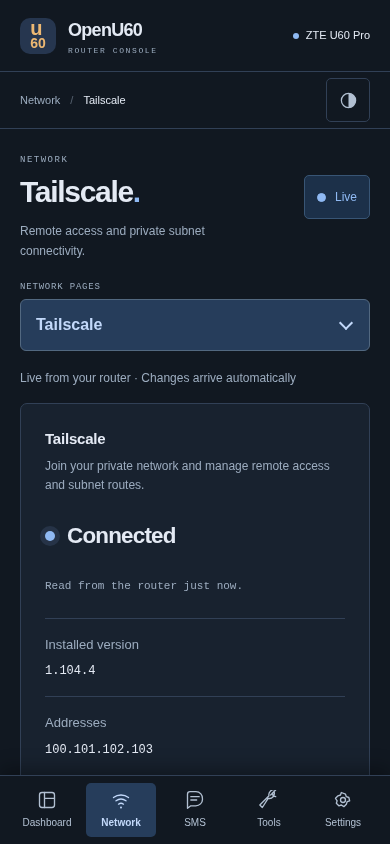

# 网络服务管理

本 fork 的 Web 管理页提供 **Network → Proxies** 和 **Network → Tailscale**，地址分别为 `/console/#network/proxy`、`/console/#network/tailscale`。需要运行包含这些页面的 fork 版后台；原厂 Web 管理程序与旧版后台不会自动增加入口。

机身统一放在「网络」：「VPN 与组网」提供 Tailscale 和 WireGuard 两个入口。Tailscale 内集中提供「连接与登录」「网络设置」「连通性检测」「安装与更新」，概览快捷入口也进入同一菜单。代理位于「代理 → 具体服务」。Web 对应入口也位于 Network。每种代理独立安装、配置和启停，可同时运行；没有全局选中内核或自动停掉其他服务的逻辑。仅在实际监听端口或接管规则冲突时拒绝启动，并保留已运行服务。

## 代理服务

1. 打开 **Network → Proxies**，在服务列表进入具体服务；列表展示各自的运行状态。
2. **Installation** 安装或更新该服务。填写可信发行文件的 HTTPS 地址、版本及 SHA-256；需要静态 Linux ARM64 程序，支持单文件 gzip 压缩，校验值对应下载文件。
3. **Configuration** 上传、粘贴或读取已保存的原生 YAML / JSON，也可以从 HTTPS URL 导入一次。不同内核使用自己的配置格式，不转换成统一的上层配置模型。配置上限 512 KiB，停止当前服务后才可校验保存。
4. **Overview** 设置该服务的运行模式、流量范围、本地 HTTP / SOCKS 端口、IPv6 与并发连接选项。规则、全局和直连是当前适配器的模式，不是所有代理的必选字段。
5. **Proxy groups** 选择手动代理组中的节点；自动测速、故障转移与负载均衡组按自己的配置运行。自动刷新会保留尚未提交的节点选择。

本地 HTTP / SOCKS 默认监听回环地址的 7890 端口，可改为其他未占用端口。热点接管只影响所选服务的规则；多种服务同时运行不等于它们可以无条件接管同一份流量。

启用状态会保存，后台下次启动时尝试恢复。停止、内核退出或所属后台进程消失时，独立清理进程撤销本服务的转发规则；热点恢复普通直连。需要始终阻止直连的场景，目前不适用这一恢复策略。

订阅 URL 仅用于本次下载，不保存到设置，也不自动定时更新。配置中的远端 provider 可按其更新周期自行刷新。浏览器离开页面或锁定时清空草稿、认证密钥和授权链接；只有主动点击读取并确认后，才将该服务的完整配置载入编辑器；响应禁止缓存，离页或锁定后清空。

导入保留节点、代理组、规则、远端 provider、DNS 上游、嗅探和其他受支持的原生选项。运行页中的明确覆盖项、设备监听地址、控制凭据、provider 缓存路径、TUN 与流量接管由该服务管理；本地域名 DNS 路由保留设备原有解析。当前不接受脚本、文件型 provider 或指向本地私钥文件的配置。远端 provider 必须使用 HTTPS，其缓存路径被限定在服务目录。依赖外部规则数据的配置仍需相应资源可下载。

公开说明不展示具体内核的管理页截图。功能验证使用合成配置和交互断言。

## Tailscale

页面可以查看安装版本、连接状态、地址、健康提示和更新结果，并提供启停、浏览器授权、认证密钥入网、退出登录、版本安装及网络设置。

内核网关模式的远程 Web 入口为 `http://<Tailscale 地址>:9091/`，热点内仍使用 `http://192.168.0.1:9090/`。独立的远程端口避免 Serve 与后台争用 9090；Web 和机身页面均显示当前远程端口。升级仅迁移本项目的 `9090 → 127.0.0.1:9090` 转发，其他 Serve 配置会保留；目标端口已有其他处理器时拒绝覆盖。

- **Accept remote subnet routes** 控制接收其他节点发布的子网。在内核网关模式下生效；这就是让 U60 热点设备访问远端局域网的设置。
- **Advertised IPv4 routes** 是由 U60 发布给其他节点的路由，需在 Tailscale 管理端批准。两项设置的方向不同。
- **Tailscale SSH** 和 **Keep network awake** 分别控制远程 SSH 与保持设备唤醒。
- 首次授权可点击 **Authorize this router**，再打开授权页登录。已经入网时直接读取实际状态，不重复提交认证密钥。
- 安装表单默认版本 `1.104.4`，可修改；SHA-256 对应官方 `tailscale_<版本>_arm64.tgz` 完整安装包。更新进度在页面可见时刷新。

仅打开这个页面不会把已有安装从设备访问模式切换成内核网关。热点子网网关的安装与规则部署见 [网关说明](../local-tools/tailscale-gateway/README.md)。停止、退出登录或更新可能中断当前远程会话。

## 网络共存与恢复

热点代理仅匹配 `br-lan`、`wlan0`、`wlan2` 的入站转发，排除 USB 管理与设备自身发起的连接。规则先查询现有 Tailscale 路由，再保留主表的局域网路由和私网目的地，最后进入代理 TUN。不会改写 Tailscale 的表 52，也不会清空系统路由或防火墙。

本功能使用 TUN `u60proxy0`、路由表 `20260`、策略优先级 `10020 / 10030 / 10070` 和 `U60_PROXY_*` 防火墙链。占用冲突时拒绝启动。IPv4 与 IPv6 同时设置，任一失败撤销本次规则。DNS 接收规则在监听器启动前设置，控制接口始终绑定回环地址。`.home.arpa` 与 `.lan` 查询交给设备原有的 DNS，保留本地管理域名解析。

私有文件位于 `/data/u60-proxy/`：目录权限 0700，配置权限 0600，内核权限 0700。控制凭据在每次启动时随机生成；日志不保留原始配置、下载 URL 或内核输出。不要把这个目录、真实配置或原始设备截图提交到 Git。

## 接口与扩展

| 方法与路径 | 用途 |
| --- | --- |
| GET /api/proxy/services | 独立服务列表及各自状态 |
| GET /api/proxy/{service}/status | 指定服务状态，不含配置凭据 |
| GET /api/proxy/{service}/groups | 当前适配器的代理组 |
| GET /api/proxy/{service}/config | 主动读取该服务保存的配置；认证、禁止缓存 |
| PUT /api/proxy/{service}/settings | 该内核自己的运行设置 |
| POST /api/proxy/{service}/enable、disable、restart | 只操作指定服务 |
| POST /api/proxy/{service}/select | 该内核的代理组节点选择 |
| POST /api/proxy/{service}/config、subscription、install | 该服务的配置和程序维护 |

旧的 /api/proxy/... 路径继续指向原有服务，兼容已安装客户端，不代表全局代理状态。旧安装目录和配置继续保留；旧适配器标识可读取，新界面使用服务身份。未来新增服务需各自实现配置页与管理协议，不套用已有内核的字段。

Tailscale 复用既有的八个管理接口；`PUT /api/tailscale/config` 新增 `accept_routes` 布尔字段。旧配置默认保持原有网关接受路由的行为；状态增加 `accept_routes_effective`，只有内核网关已连接时才报告启用。这是路由接受偏好，不能代替路由审批、访问控制或目标服务可达性验证。

服务目录仅汇总各服务状态和分派操作；运行配置、私有存储、生命周期锁和控制协议归各自实现所有。目录不要求共享模式或配置格式，也没有全局运行锁。网络层按实际资源检查占用，不能替其他服务清理规则。

## 验证范围

2026-11-03：后台回归 1060 项通过，机身 45 项通过；3 项独立进程测试覆盖后台断开、内核退出后的清理、启动与清理的互斥及锁释放。Chrome 浏览器测试覆盖导入、安装、切换、授权、设置、离页确认失效、锁定后迟到响应隔离、明暗主题与手机/平板/桌面宽度。截图全部来自合成数据。

在 B31 上，实际 ARM64 内核通过两种生成配置的检查；临时仅回环监听的运行验证覆盖控制接口、路由组切换和 HTTP 代理转发，随后停止并清理。没有启用实际热点接管；真实订阅可用性、热点端到端转发、与 Tailscale 同时承载流量，以及固件网络重载后的行为仍需实际验收。

该阶段构建均为静态 ARM64/musl。后台 ELF 7,082,968 字节，`size -A` Total 7,074,892，gzip level 9 / mtime 0 为 3,426,678 字节；SHA-256：`ae2d0132a5694167a8ce96a92d382b9c6b08dce63b8b05f5d476ff3289acb6bc`。机身产物体积见 [接入记录](../u60-screen/LIVE.md)。

随后已完成后台与屏幕的首次常驻部署。实机确认 Tailscale 在线且没有健康告警、既有子网路由保留，远程 Web 转发已从 9090 迁移到 9091；后台通过认证及实时数据检查。新的回归结果、构建体积与尚未验证的范围见 [部署验证记录](deployment.md#验证范围)。

布局与配置调整：后台完整回归 1066 项通过（3 项忽略），机身 47 项通过，严格 Clippy 通过。B31 临时校验内核接受本地与热点两种生成配置，覆盖原生 DNS 与嗅探选项；本次校验不启动代理、不改变现有流量。浏览器检查覆盖独立服务列表、原生配置读取与保存、分组草稿刷新、明暗主题和多种宽度。仅实现现有首个内核；其他内核尚未接入，不代表多种真实内核同时运行已完成实机验收。
