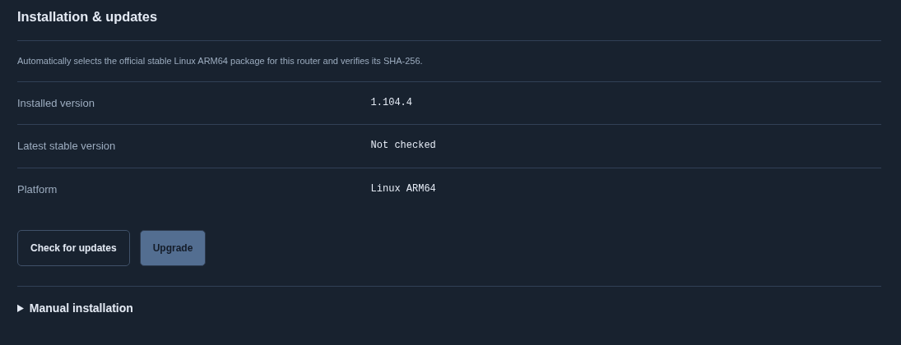

# 网络服务管理

本 fork 的 Web 管理页提供 **Network → Proxies** 和 **Network → Tailscale**，地址分别为 `/console/#network/proxy`、`/console/#network/tailscale`。需要运行包含这些页面的 fork 版后台；原厂 Web 管理程序与旧版后台不会自动增加入口。

机身统一放在「网络」：「VPN 与组网」提供 Tailscale 和 WireGuard 两个入口。Tailscale 内集中提供「连接与登录」「网络设置」「连通性检测」「安装与更新」，概览快捷入口也进入同一菜单。代理位于「代理 → 具体服务」。Web 对应入口也位于 Network。每种代理独立安装、配置和启停，可同时运行；没有全局选中内核或自动停掉其他服务的逻辑。仅在实际监听端口或接管规则冲突时拒绝启动，并保留已运行服务。

## 代理服务

1. 打开 **Network → Proxies**，在服务列表进入具体服务；列表展示各自的运行状态。
2. **Installation → Check for updates** 查询官方稳定版，自动选择 U60 对应的 Linux ARM64 包及 SHA-256，展示当前版本和可用版本；再点 **Install release / Upgrade** 确认安装。正常使用无需填写下载地址、版本或校验值。
3. **Configuration** 自动读取当前保存的原生 YAML / JSON，支持编辑、文件导入和一次性 HTTPS 订阅导入。配置上限 512 KiB，不同内核使用自己的配置格式。**Validate configuration** 只做校验；服务停止时使用 **Save configuration**，运行时使用 **Save and reload**，无需先停止进程。
4. **Overview** 设置该服务的运行模式、流量范围、本地 HTTP / SOCKS 端口、IPv6 与并发连接选项。规则、全局和直连是当前适配器的模式，不是所有代理的必选字段。停止时点击 **Save runtime settings（保存运行设置）**，下次启动应用；运行时点击 **Save and restart（保存并重启）**，先校验再重启当前服务，失败后尝试恢复旧设置和进程。
5. **Proxy groups** 选择手动代理组中的节点；自动测速、故障转移与负载均衡组按自己的配置运行。自动刷新会保留尚未提交的节点选择。

**Logs（日志）** 显示启动和运行输出，服务停止或启动失败后仍可查看。支持自动刷新、手动刷新和清空；两份文件各最多 256 KiB，页面返回最新约 96 KiB，超长行不保存。捕获前移除已识别的配置凭据和 HTTP(S) URL；reload 后更新凭据过滤。日志只在已认证页面显示，离开服务页或锁定后清空页面内容。

**扩展面板** 入口可独立检查更新、安装官方静态前端并校验 SHA-256，也可手动上传 `.tgz` / `.tar.gz` 包。静态面板不包含在内核二进制中；仅设置控制监听端口不会提供面板文件。安装完成并启动本服务后，点击打开即可在新标签页自动连接，无需另填地址、端口或密钥。它复用现有管理地址，支持代理组、连接、规则、测速和实时日志；运行配置、进程启停和内核升级仍在本项目控制台操作。内核的 `external-ui` 路径不会直接用于安装该面板。

面板连接使用绑定当前后台会话及本次内核运行的短期凭据，有效期一小时；后台会话失效、重启内核后需从控制台重新打开。面板不接收后台管理令牌或内核控制密钥，不新增局域网控制端口。安装面板不会重启代理进程。官方发行信息受限流或网络影响时显示错误，可稍后重试或手动上传官方静态包。

手动安装位于 **Manual installation** 折叠区：选择电脑上的 Linux ARM64 gzip 包或静态可执行文件，最多 96 MiB。官方文件名自动识别版本，重命名过的文件才需要补填版本。程序先检查包与已有配置，再替换内核；原先运行的服务会短暂重启，启动失败则尝试恢复原程序。配置和启用偏好保留，其他服务不随之停止。

首次校验和启动会先准备规则数据库，再调用内核校验。后台从配置中的 `geox-url` 下载所需数据，未指定时使用适配器的默认来源；有效缓存会复用。下载有独立的时间和大小限制，在私有临时目录检查 HTTP 长度、DAT 消息边界以及内核可读性，全部通过后才替换缓存。校验进程超时或下载中断不会留下半截活动数据库。失败时保留原配置和已有缓存，不删除或放宽任何规则。

**Prepare / repair rule databases（准备／修复规则数据）** 按编辑器草稿中的来源重新下载所需数据库并校验；操作要求本服务停止，成功后保留草稿，仍需点击保存配置。它也适用于更换下载源后主动刷新缓存。常见的“分类不存在”既可能是数据源缺少该分类，也可能是文件被截断，不能直接据此删除规则。

如果设备无法直连下载源，打开 **Offline rule databases（离线导入规则数据库）**，先在电脑下载完整文件，再上传 `GeoIP.dat`、`GeoSite.dat`、`geoip.metadb` / `Country.mmdb` 或 `ASN.mmdb`；每个文件最多 64 MiB，按文件名自动识别类型。文件分块上传并通过结构检查及实际内核校验后替换，导入不启动服务。完整的离线文件会作为缓存复用，可以继续校验、保存并启动，无需先让代理联网来下载这些数据库。远端 provider 及运行期间的定时数据更新仍遵循内核配置，离线导入数据库不代表所有远端资源均已缓存。

本地 HTTP / SOCKS 默认监听回环地址的 7890 端口，可改为其他未占用端口。热点接管只影响所选服务的规则；多种服务同时运行不等于它们可以无条件接管同一份流量。

启用状态会保存，后台下次启动时尝试恢复。停止、内核退出或所属后台进程消失时，独立清理进程撤销本服务的转发规则；热点恢复普通直连。需要始终阻止直连的场景，目前不适用这一恢复策略。

订阅 URL 仅用于本次下载，不保存到设置，也不自动定时更新。配置中的远端 provider 可按其更新周期自行刷新。进入配置页后读取该服务的已保存配置，响应禁止缓存。文件选择载入草稿，再点 **Import and apply file** 或编辑器的保存按钮应用；**Import and apply subscription** 接受直接返回 YAML / JSON 的 HTTPS 地址，随后下载、校验、保存并回读，成功后直接显示可编辑内容。URL 使用可见文本输入。后台使用该服务对应的订阅客户端标识。配置保留有效字段，编辑器显示标准化 YAML，不保留原始注释和排版。浏览器离开页面或锁定时清空草稿、认证密钥、订阅地址和授权链接。

编辑器顶部提供读取、校验、保存与重新加载按钮，错误也显示在文本框上方。只有配置重新读回且版本标识一致，才确认保存成功；失败保留草稿。状态刷新不会覆盖未保存编辑；其他窗口已修改配置时拒绝覆盖，需重新读取后再决定。**Reload saved configuration** 重新应用已保存内容，保留编辑器草稿。机身也提供「重新加载配置」，操作前核对运行状态和配置版本。

运行中先校验候选配置，再经本服务控制接口 reload，最后保存并核对文件；失败尝试重新加载原配置并明确报告恢复结果。只改本服务配置，沿用其控制凭据和运行模式。

导入保留节点、代理组、规则、远端 provider、DNS 上游、嗅探和其他受支持的原生选项。运行页中的明确覆盖项、设备监听地址、控制凭据、provider 缓存路径、TUN 与流量接管由该服务管理；本地域名 DNS 路由保留设备原有解析。当前不接受脚本、文件型 provider 或指向本地私钥文件的配置。远端 provider 必须使用 HTTPS，其缓存路径被限定在服务目录。依赖外部规则数据的配置仍需相应资源可下载。

公开说明不展示具体内核的管理页截图。功能验证使用合成配置和交互断言。

## Tailscale

页面可以查看安装版本、连接状态、地址、健康提示和更新结果，并提供启停、浏览器授权、认证密钥入网、退出登录、版本安装及网络设置。

内核网关模式的远程 Web 入口为 `http://<Tailscale 地址>:2027/`，热点内使用 `http://192.168.0.1:2026/`。独立的远程端口避免 Serve 与后台争用监听地址；Web 和机身页面均显示当前远程端口。升级识别并迁移本项目原有的 `9090` / `9091` 和 `20600` / `20601` 转发，其他服务的转发会保留；新目标端口已有其他处理器时拒绝覆盖。恢复原部署时按记录的旧端口恢复本项目转发。

- **Accept remote subnet routes** 控制接收其他节点发布的子网。在内核网关模式下生效；这就是让 U60 热点设备访问远端局域网的设置。
- **Advertised IPv4 routes** 是由 U60 发布给其他节点的路由，需在 Tailscale 管理端批准。两项设置的方向不同。
- **Tailscale SSH** 和 **Keep network awake** 分别控制远程 SSH 与保持设备唤醒。
- 首次授权可点击 **Authorize this router**，再打开授权页登录。已经入网时直接读取实际状态，不重复提交认证密钥。
- 页面上方的 **Installation & updates → Check for updates** 从官方稳定源读取当前版本，自动选择 `tailscale_<版本>_arm64.tgz` 并获取 SHA-256；再确认 **Install release / Upgrade**。仅检查不会安装，也不会把已有 `1.104.4` 自动升级。
- 指定版本或离线安装使用 **Manual installation**，上传电脑上的官方 ARM64 `.tgz` 包，最多 120 MiB；官方文件名无需另填版本。页面显示上传、下载、验证、安装和结果，完成后重新读取服务状态。

仅打开这个页面不会把已有安装从设备访问模式切换成内核网关。热点子网网关的安装与规则部署见 [网关说明](../local-tools/tailscale-gateway/README.md)。停止、退出登录或更新可能中断当前远程会话。

检查发行版本需要设备能访问官方源。遇到离线或发行源限流时保留现有安装，并显示错误；可稍后重试，或在电脑上下载官方包后手动上传。手动包会验证大小、结构、架构与可执行性，显示计算得到的摘要，但摘要本身不代表经过官方认证。更新为用户主动操作，不做定时自动升级。

## 网络共存与恢复

热点代理仅匹配 `br-lan`、`wlan0`、`wlan2` 的入站转发，排除 USB 管理与设备自身发起的连接。规则先查询现有 Tailscale 路由，再保留主表的局域网路由和私网目的地，最后进入代理 TUN。不会改写 Tailscale 的表 52，也不会清空系统路由或防火墙。

本功能使用 TUN `u60proxy0`、路由表 `20260`、策略优先级 `10020 / 10030 / 10070` 和 `U60_PROXY_*` 防火墙链。占用冲突时拒绝启动。IPv4 与 IPv6 同时设置，任一失败撤销本次规则。B31 的 DNS 本机地址匹配使用启动时读取的实际地址，不依赖缺失的 `addrtype` 扩展；设备地址变化后需要重启本服务刷新匹配。DNS 接收规则在监听器启动前设置，控制接口始终绑定回环地址。`.home.arpa` 与 `.lan` 查询交给设备原有的 DNS，保留本地管理域名解析。

私有文件位于 `/data/u60-proxy/`：目录权限 0700，配置权限 0600，内核权限 0700。控制凭据在每次启动时随机生成；运行日志按上述限制捕获并过滤，不保存原始配置和下载 URL。不要把这个目录、真实配置或原始设备截图提交到 Git。

## 接口与扩展

| 方法与路径 | 用途 |
| --- | --- |
| GET /api/proxy/services | 独立服务列表及各自状态 |
| GET /api/proxy/{service}/status | 指定服务状态，不含配置凭据 |
| GET /api/proxy/{service}/groups | 当前适配器的代理组 |
| GET /api/proxy/{service}/config | 主动读取该服务保存的配置；认证、禁止缓存 |
| GET /api/proxy/{service}/logs | 有界的近期启动及运行日志；认证、禁止缓存 |
| POST /api/proxy/{service}/logs/clear | 清空本服务保留的日志 |
| GET /api/proxy/{service}/panel | 扩展面板安装及版本状态 |
| POST /api/proxy/{service}/panel-session | 建立短期面板连接 |
| PUT /api/proxy/{service}/settings | 该内核自己的运行设置；运行时需显式确认 restart |
| POST /api/proxy/{service}/enable、disable、restart | 只操作指定服务 |
| POST /api/proxy/{service}/select | 该内核的代理组节点选择 |
| POST /api/proxy/{service}/config、subscription、install | 该服务的配置和程序维护 |
| POST /api/proxy/{service}/validate | 校验编辑内容，不保存或 reload |
| POST /api/proxy/{service}/geodata | 按草稿准备／修复规则数据库；要求本服务停止，不保存草稿 |
| POST /api/proxy/{service}/reload | 校验并重新加载已保存配置 |
| GET /api/software/{service}/status | 安装任务阶段、进度、结果与已查询的发行版本 |
| GET /api/software/{service}/release | 查询官方稳定版及对应架构的包与摘要 |
| POST /api/software/{service}/install | 安装刚查询的版本；版本和摘要须匹配服务端查询结果 |
| POST /api/software/{service}/upload | 建立有大小上限的手动上传 |
| POST /api/software/{service}/upload/chunk | 按偏移上传最多 256 KiB 的 Base64 数据 |
| POST /api/software/{service}/upload/install、upload/cancel | 完成上传并安装，或取消未完成的上传 |

旧的 /api/proxy/... 路径继续指向原有服务，兼容已安装客户端，不代表全局代理状态。旧安装目录和配置继续保留；旧适配器标识可读取，新界面使用服务身份。未来新增服务需各自实现配置页与管理协议，不套用已有内核的字段。

Tailscale 保留既有的八个管理接口；`PUT /api/tailscale/config` 新增 `accept_routes` 布尔字段。旧配置默认保持原有网关接受路由的行为；状态增加 `accept_routes_effective`，只有内核网关已连接时才报告启用。这是路由接受偏好，不能代替路由审批、访问控制或目标服务可达性验证。

软件安装接口复用现有认证和跨站请求检查，写入要求已设置后台密码。每种服务独立排队，仍由各自的管理器负责配置、启停与恢复。上传暂存于 `/data/u60-software/` 私有目录；完成、取消或检测到 20 分钟未继续上传时删除临时包。离页或锁定会清空文件选择并尝试取消未完成上传；已经接受的安装在后台继续，重新进入页面可查看进度。

服务目录仅汇总各服务状态和分派操作；运行配置、私有存储、生命周期锁和控制协议归各自实现所有。目录不要求共享模式或配置格式，也没有全局运行锁。网络层按实际资源检查占用，不能替其他服务清理规则。

## 验证范围

2026-11-03：后台回归 1060 项通过，机身 45 项通过；3 项独立进程测试覆盖后台断开、内核退出后的清理、启动与清理的互斥及锁释放。Chrome 浏览器测试覆盖导入、安装、切换、授权、设置、离页确认失效、锁定后迟到响应隔离、明暗主题与手机/平板/桌面宽度。截图全部来自合成数据。

在 B31 上，实际 ARM64 内核通过两种生成配置的检查；临时仅回环监听的运行验证覆盖控制接口、路由组切换和 HTTP 代理转发，随后停止并清理。没有启用实际热点接管；真实订阅可用性、热点端到端转发、与 Tailscale 同时承载流量，以及固件网络重载后的行为仍需实际验收。

该阶段构建均为静态 ARM64/musl。后台 ELF 7,082,968 字节，`size -A` Total 7,074,892，gzip level 9 / mtime 0 为 3,426,678 字节；SHA-256：`ae2d0132a5694167a8ce96a92d382b9c6b08dce63b8b05f5d476ff3289acb6bc`。机身产物体积见 [接入记录](../u60-screen/LIVE.md)。

随后已完成后台与屏幕的首次常驻部署。实机确认 Tailscale 在线且没有健康告警、既有子网路由保留，远程 Web 转发已从 9090 迁移到 9091；后台通过认证及实时数据检查。新的回归结果、构建体积与尚未验证的范围见 [部署验证记录](deployment.md#验证范围)。

布局与配置调整：后台完整回归 1066 项通过（3 项忽略），机身 47 项通过，严格 Clippy 通过。B31 临时校验内核接受本地与热点两种生成配置，覆盖原生 DNS 与嗅探选项；本次校验不启动代理、不改变现有流量。浏览器检查覆盖独立服务列表、原生配置读取与保存、分组草稿刷新、明暗主题和多种宽度。仅实现现有首个内核；其他内核尚未接入，不代表多种真实内核同时运行已完成实机验收。

安装与更新调整：后台 1071 项回归通过，机身此前 54 项回归通过。新增检查覆盖版本与架构选择、摘要缺失、分块上传顺序和大小、文件权限、临时包清理、压缩包链接及重复文件拒绝、无效程序不替换旧安装、上传接口认证。浏览器验证两种服务检查与升级、取消确认、分块上传失败后重试、安装响应中断后读取真实进度、离页确认失效及锁定后的迟到响应隔离；五种语言的认证实时连接回归通过。测试使用合成服务，不在设备上执行真实升级；运行中的新版本切换及恢复仍需实机验收。

官方元数据在线验证：Tailscale 选择到稳定版 `1.104.5` 的 ARM64 包并取得有效校验值。代理发行源的直接请求返回限流；界面错误与重试流程已通过模拟验证，这项在线检查不计入成功项。没有因此尝试改用未验证的下载源。

配置编辑与 reload：后台 1074 项、机身 55 项回归通过。覆盖保存回读、错误成功响应、草稿保留、配置版本冲突、仅校验不写入、reload 响应丢失后的恢复，以及机身新接口超时。B31 上用仅监听回环的临时实例验证实际内核接受新配置、拒绝错误配置、恢复原配置，进程 PID 保持不变；测试实例和文件已清理。测试使用合成配置，用户真实订阅及热点代理转发仍需更新后验收。

YAML 导入修复：标准锚点和 `<<` 合并先展开，再转为保存格式；显式字段优先，文件和 URL 导入使用同一解析流程。校验接口与保存接口支持相同的 512 KiB 配置上限。内核拒绝时返回具体校验原因，诊断文本限制长度并移除凭据和 URL。B31 实机使用合成 AnyTLS 节点复现：原始锚点 YAML 通过，未展开的中间格式因组类型缺失失败，展开后通过；未启动代理或改动热点路由。

后续实机校验：Rust 实际生成的锚点配置在本地代理和热点两种运行配置下均通过内核校验。另用合成节点复现用户提供的 AnyTLS、地区测速组、业务规则、Geo 数据及 DNS 结构，首次下载 Geo 数据并完成校验约 14 秒。后台串行全量 1079 项、原生屏幕 55 项、部署 23 项回归通过；配置导入、可见 URL、五种语言与布局的浏览器回归通过。未用用户真实节点建立代理连接。

规则数据库修复验证（2026-11-04）：发现一份截断的 GeoIP 缓存，2,916,352 字节；对应下载源完整文件为 16,546,071 字节。设备上已备份旧文件并原子替换，合成规则配置通过原内核检查。实际 Rust 准备流程从截断缓存出发，下载并交给 B31 内核校验通过，用时约 67 秒。后台回归 1086 项、屏幕 55 项通过；公开 GeoIP / GeoSite 完整文件与截断样本通过检查。浏览器覆盖准备失败与成功保留草稿、离线上传中断、安装响应丢失后的状态回读、五种语言与布局。该验证未使用用户节点建立代理连接。

热点兼容与诊断验证（2026-11-04）：B31 实机复现 `addrtype` 匹配不可用，在未挂入系统流量路径的临时链中验证 IPv4 / IPv6 替代规则通过，测试链已清理。后台串行回归 1094 项通过；独立进程测试覆盖日志保留与退出清理，另验证运行设置保存后重启和启动失败后恢复旧设置。浏览器覆盖错误信息、草稿保留、日志清空、面板安装与自动连接；官方静态前端实际加载并通过实时通道检查。HTTP / WebSocket 桥接测试覆盖凭据转换、路径限制、会话撤销与双向数据。尚未用真实热点客户端完成端到端代理转发验收。系统 Clippy 仍报告仓库既有告警，新改动无新增检查项；官方面板发行 API 本次受限流，在线安装未在设备执行。
