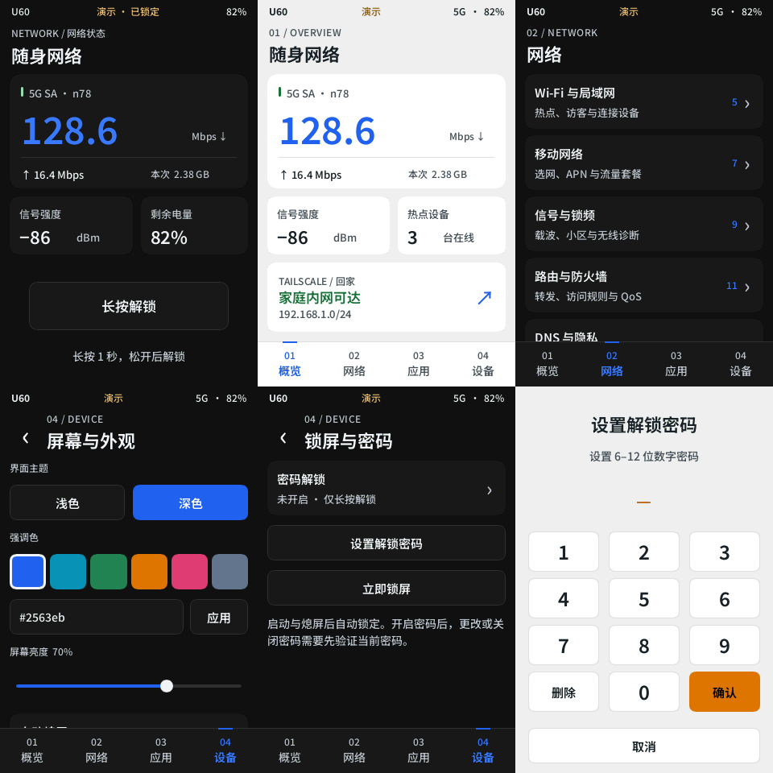

# 原生屏幕开发

独立的 Rust + Slint 1.18.1 程序，同一份 320×480 页面支持 Linux 桌面预览、无窗口 PNG 截图和 U60 机身屏幕。构建与锁文件独立于上游 agent，合并上游时无需把图形依赖带进 agent。

**已接入全部 82 个设计入口。** 机身试运行默认连接本机 agent：锁屏和首页显示真实网速、信号、网络制式与电量，解锁后读取设备数量和 Tailscale 服务状态。认证使用已有的 HTTP 登录接口，实时数据使用 SSE；熄屏立即关闭订阅，亮屏重新获取快照。连接失败、无读数和过期快照显示未知状态，不混入演示数值。

13 个分类、82 个功能入口均有原生实现；备份恢复、客户端局域网测速和手机实时活动保留必要的配套流程。固件或后台缺失的接口会禁用相应操作，不显示虚构读数。桌面默认仍为演示模式，完整的模拟表单交互保留在 `preview/`。已接入的设置页在用户确认后通过 agent 写入，具体范围及验证边界见 [原生功能接入记录](LIVE.md)。

本地设置包括外观、6 种预设强调色、HEX 配色、亮度、自动熄屏和检测目标。设备端实际写入背光节点；偏好保存这些本机设置，不保存密码。拖动亮度会合并保存，避免每个触摸事件都写闪存。检测目标、后台密码和 HEX 共用触屏键盘，支持英文大小写、数字、ASCII 符号以及光标和选择；电脑键盘也可输入。取消、锁屏或熄屏会清空编辑框；此键盘尚不提供中文输入法。



## 锁屏与密码

启动、熄屏和手动锁屏后，屏幕进入**只读状态看板**：网络制式、上下行网速、信号强度和电量仍然可见，数据与主页共用同一模型。设置、短信和其他操作入口受锁定状态约束。

长按「长按解锁」至少 1 秒后松开；移出按钮会取消。默认仅用长按防误触。在「设备 → 锁屏与密码」可开启可选的 **6–12 位数字密码**，需要输入两次确认；修改或关闭时必须验证现有密码。开启后，长按只进入数字键盘，正确验证后才能操作。触摸唤醒只亮屏，保持锁定。

密码以独立随机盐的 Argon2id 校验值保存（19 MiB、2 次迭代、1 lane），不保存明文，不写日志，也不发送到网络。密码输入在 Rust 内存里处理，界面只持有掩码；哈希计算在工作线程完成。连续 5 次错误后等待 30 秒，之后递增到最多 5 分钟。尝试计数在开始校验前持久化，重启程序后保留；验证结果未能保存、配置损坏或验证被取消时不放行。

私有文件位于外观文件同级的 `.screen-private/screen-lock.private.json`（目录 0700、文件 0600），设备端对应 `/data/local/tmp/u60-native-screen/.screen-private/`。修改外观不会清除密码。

这是**自定义屏幕程序的操作锁**。试运行结束后原厂 UI 按原厂规则工作；该锁不修改原厂界面、网页后台认证、ADB 或 SSH，也不防御已有 root 权限的管理员。忘记密码时，可在已授权的 root 终端结束试运行后，将该私有文件移出原位置，再运行程序重新设置；程序不会自动清除损坏的密码配置。

## 在电脑上运行

需要 Rust 1.92 或更新版本、Cargo，以及 Linux 桌面的 X11 或 Wayland 运行库。默认使用 Winit + 软件渲染，不依赖 GPU 加速。命令均从仓库根目录执行：

```bash
bash u60-screen/native.sh preview
```

窗口逻辑尺寸固定为 320×480；桌面系统可能按显示缩放比例放大。左右方向键切换一级导航，Escape 返回，空格熄屏/唤醒，鼠标拖动滚动。外观默认保存在被 Git 忽略的 `u60-screen/appearance.json`。

```bash
# 指定初始页面和浅色；也可在界面内切换
bash u60-screen/native.sh preview --page screen-prefs --light

# 不需要图形桌面的截图；使用与设备一致的 RGB565 软件渲染
bash u60-screen/native.sh snapshot /tmp/u60.png --light --page tailscale-network
```

`--page` 支持 `overview`、`network-menu`、`apps`、`device-settings`、分类 ID 及功能 ID；完整列表在 `assets/catalog.json`。例如 `wifi2`、`nr-bands`、`wireguard`、`agent-update`、`screen-lock`。`--screenshot /tmp/lock.png --page lock` 输出锁屏。离屏演示截图可以展示未设密码的页面；提供了密码配置时仍保留锁屏。设备运行无法使用截图模式绕过锁定。

## 构建设备程序

### 后台连接

机身程序仅向 `127.0.0.1:2026` 登录。它从运行中的 `/data/zte-agent`（兼容 `/data/local/tmp/zte-agent`）root 进程读取已有的密码环境变量，通过正常登录取得独立 bearer token；不会更改 agent 密码，也不会绕过认证。密码不进入参数、日志或第二份配置文件。会话 token 单独保存在 `.screen-private/agent-session.private.json`，目录 0700、文件 0600；过期后重新登录。

桌面连接需要先建立 ADB/SSH 本地隧道，例如：

```bash
adb forward tcp:19090 tcp:2026
bash u60-screen/native.sh preview --agent 127.0.0.1:19090
```

在「设备 → 后台连接」输入后台密码。客户端只接受 loopback 地址、禁用代理和重定向，避免把明文登录转发到其他主机。`--demo` 可强制使用演示数据；该参数不能和连接选项混用。

`--probe-agent --local-agent` 在设备上只检查认证和信号、流量、电量三个实时主题，不接管屏幕，不输出原始数据或凭证。

`--probe-features --local-agent` 核对已接入功能的读取接口，只输出每页读取成功数和字段数；不执行业务写入、不接管显示。eSIM 列表读取可能恢复后台回执，STK 菜单可能初始化卡片会话，因此这两类页面会跳过。可与 `--prefs` 复用已有本机会话。

### Tailscale 连通性检测

「应用 → Tailscale 网络」独立显示服务状态、目标路由、目标 TCP 服务和热点转发规则。在「检测目标」输入 `IP:端口` 或 `[IPv6]:端口`；留空关闭检测。初始目标为空，不绑定任何网段或使用地点。设置只保存在本机偏好文件，不随源码发布。

仅当该页面亮屏解锁且 Tailscale 已连接时，每 30 秒检测一次；结果 60 秒后过期。锁屏/熄屏取消进行中的检测。程序先检查实际路由，再将 TCP socket 绑定到 `tailscale0`，防止路由变化后从蜂窝网络探测目标。检测不改变路由或防火墙，不向目标发送应用层数据。

「热点转发规则已配置」要求 IP 转发开启、当前 LAN 网段匹配，以及本项目管理的转发/回程/NAT 规则齐全。兼容旧部署的规则标记。这只能确认规则存在；**U60 的 TCP 连接成功也不能替代热点客户端的实际访问测试**。桌面经隧道读取 agent 状态时，不从电脑代替设备探测，会提示到机身屏幕检测。

也可在设备终端配置或检查，不接管显示（示例目标需替换）：

```sh
/data/local/tmp/u60-native-screen/u60-screen --prefs /data/local/tmp/u60-native-screen/appearance.json --set-probe-target 10.20.0.10:443
/data/local/tmp/u60-native-screen/u60-screen --check-target 10.20.0.10:443
```

终端配置应在屏幕程序退出时执行，避免运行中的旧偏好覆盖它。检查只输出路由、TCP、转发规则和耗时，不输出目标地址或后台凭证；IPv6 需按设备实际路由配置使用，目前配套网关部署工具只配置 IPv4 子网。

### 交叉编译

需要 `aarch64-unknown-linux-musl` Rust 标准库及交叉链接器。脚本优先使用 `aarch64-linux-musl-gcc`，也支持这台 Linux 开发机上的 `aarch64-unknown-linux-gnu-gcc` 驱动，musl 的 CRT/libc 来自 Rust target。使用 GNU 驱动时需确认产物仍为静态 musl 程序，不能因此引入设备不存在的 glibc 动态依赖。

```bash
bash u60-screen/native.sh build-device
```

默认产物：`target/u60-screen/aarch64-unknown-linux-musl/release/u60-screen`。支持 `CARGO_TARGET_DIR`、`CARGO`、`RUSTC`、`CARGO_TARGET_AARCH64_UNKNOWN_LINUX_MUSL_LINKER` 覆盖。存在 `~/.local/share/u60-build/` 时会复用该项目已有的 Rust 工具链与缓存。

直接使用 Cargo 等价于：

```bash
cargo build --locked --release --manifest-path u60-screen/Cargo.toml \
  --target aarch64-unknown-linux-musl --no-default-features --features device
```

字体和页面嵌入二进制。设备构建不包含 Winit、X11、Wayland、Mesa、libinput 或 libudev 后端。Fontique 的 fontconfig 发现使用可选动态加载，缺少该库时仍使用内嵌字体。

## 在 U60 上限时试运行

开启 ADB、保持数据线连接，并先让设备正常启动到原厂界面。每次最长 600 秒，默认 90 秒：

```bash
bash u60-screen/native.sh trial 120
bash u60-screen/native.sh status
```

试运行程序和日志位于 `/data/local/tmp/u60-native-screen/`。脚本核对启动同步、保存背光、启动独立恢复守护，再临时停止原厂 UI 服务；会等待原厂进程真正退出，避免 procd 的异步停止与恢复发生竞争。首帧通过 `DIRTYFB` 提交后才报告启动成功。后台 agent、Tailscale 与网络服务不参与接管。

到时自动退出并恢复原厂 UI。提前恢复：

```bash
bash u60-screen/native.sh stop
bash u60-screen/native.sh status
```

恢复守护独立于 Rust 程序和启动 shell，覆盖程序崩溃、启动 shell 被杀、ADB 会话结束及试运行超时。试运行脚本只临时 `stop/start` 显示服务，不执行 `disable`，不修改 `rc.local`、init 链接、daemon 注册列表、固件或 OTA 槽位。常驻部署由根目录的 `dash.sh` 单独管理，见 [项目部署与恢复](../docs/deployment.md)。

显示与触摸分别默认旋转 180°；触摸按设备名称和能力探测，不写死 `event3`。手工排查时可在设备运行：

```sh
sh /data/local/tmp/u60-native-screen/device-trial.sh --seconds 120 \
  --rotate 180 --touch-rotate 180
```

短按电源键切换屏幕；触摸唤醒只唤醒，不点击下面的业务控件。电源键不独占，长按仍由固件处理。当前只是关闭背光和停止无必要重绘，不代替整机的休眠、关机或充电模式管理。

如果守护日志明确报告恢复失败，先结束试运行，再启动原厂服务：

```bash
bash u60-screen/native.sh stop
adb shell /etc/init.d/zte_topsw_devui start
```

正常恢复日志应包含 `recovery: vendor UI running; backlight restored` 和 `no active trial`。残留 `/tmp/u60-native-screen-trial` 表示恢复尚未完成，不要直接删除后重试。ADB 不在线时先短按电源键唤醒并检查数据线。

## 代码分工

产品命名按网络能力区分，不绑定使用地点：

| 名称 | 含义 |
| --- | --- |
| Tailscale 网络 | 当前设备加入的虚拟网络与连接状态 |
| 子网路由 | 由其他节点发布、批准后可接收的 IP 网段 |
| 子网路由器 | 发布子网路由的 Tailscale 节点 |
| 热点转发 | 将热点客户端流量转发到指定 Tailscale 子网 |
| 连通性检测 | 验证到用户指定目标的实际路径和服务端口 |

对应页面 ID 为 `tailscale-network`，代码使用 `tailnet_*`、`subnet_*`、`probe_*` 等能力名称。旧页面 ID 仅作为兼容入口保留。Tailscale 在线、路由已接收与目标服务可达分别呈现。

| 位置 | 用途 |
| --- | --- |
| `ui/main.slint` | 主页面、详情、外观和导航 |
| `ui/components.slint` | 配色、小屏按钮、列表、亮度控件 |
| `src/app.rs` | 页面模型、演示状态、本地偏好与休眠计时 |
| `src/platform.rs` | 无窗口与设备共用的 Slint 软件平台、PNG 输出 |
| `src/device/display.rs` | 枚举 DRM、RGB565 dumb buffer、按损坏区域复制和 DIRTYFB |
| `src/device/input.rs` | evdev 触摸、MT 槽位、坐标校准、事件丢失取消、电源键 |
| `src/device/mod.rs` | 设备事件循环、背光、信号退出和试运行期限 |
| `src/config.rs` | 配色对比度、校验、原子保存 |
| `src/security.rs` | 长按解锁、密码设置与校验、持久化重试限制 |
| `ui/lock.slint` | 只读锁屏与数字键盘 |
| `ui/editor.slint` | 通用触屏文本输入，支持光标与选择 |
| `src/agent/` | 认证、SSE、数据模型与 Tailscale 路径/TCP 检测 |
| `vendor/` | 固定版本 Slint 软件字体 hinting 与整像素补丁 |
| `assets/catalog.json` | 从浏览器原型导出的共享功能目录 |
| `assets/native-features.json` | 新增功能的设计定义 |
| `scripts/device-trial.sh` | 只在设备上运行的接管与恢复守护 |

修改浏览器功能定义或新增功能后运行 `node u60-screen/scripts/export-catalog.cjs`，提交更新后的 JSON。普通 Cargo 构建无需 Node。添加中文文案后按 [字体说明](assets/FONT.md) 重新生成子集。

每完成一个可独立验证的功能或修复就提交，保持提交后的程序可编译。第三方依赖、设备适配、交互功能和文档尽量分开；同步上游也单独提交，避免在阶段末尾混成一个大提交。

## 验证与部署边界

```bash
bash u60-screen/native.sh test
cargo fmt --manifest-path u60-screen/Cargo.toml --check
cargo clippy --manifest-path u60-screen/Cargo.toml --all-targets --all-features -- -D warnings
```

测试包括全部原生入口、触摸切页、明暗与强调色、黑屏唤醒保持锁定、长按时长与取消、实际触摸数字键盘、密码设置/修改/关闭、跨进程重试限制、验证取消/存储错误不得解锁、旋转图像、含 padding 的 RGB565 帧缓冲，以及无设备参与的恢复脚本回归。脚本回归需要 Python 3 和 C 编译器，模拟原厂服务的延迟停止、正常/错误退出、UI 或启动 shell 被 SIGKILL、启动同步未完成等情况。

MU5250/B31 实机已确认 ARM 静态程序运行、内嵌中文字形、DRM 首帧刷新、显示方向、触摸导航、只读状态锁屏和长按解锁，以及限时结束后恢复原厂界面。用户确认小字清晰度改善。物理按键、不同休眠/充电模式和长时间功耗需继续验证；仅凭桌面测试不能把这些标为完成。测试范围与产物大小见 [2026-11-03 验证记录](docs/validation-2026-11-03.md)。

真实状态、Tailscale 检测、触屏编辑器与命名整理的追加验证见 [实时状态验证记录](docs/live-validation-2026-11-03.md)。

认证后的 HTTP/SSE、全部设计入口、业务表单、确认、通用输入、错误与过期状态均已接入；各类请求体直接对应当前仓库的生产接口。测试覆盖 82 个入口的契约归属及断线禁用、动态表单的触摸索引、短信回复目标、eSIM 套餐确认、二维码和多行正文。详见 [LIVE.md](LIVE.md)。

解锁后，在概览点「分享 Wi-Fi」，或进入「网络 → Wi-Fi 与局域网 → 分享 Wi-Fi」，选择频段/访客网络即可用手机扫码连接。二维码读取设备已保存的热点名称与密码，支持隐藏网络、WPA2、WPA2/WPA3 混合模式及纯 WPA3（手机需支持 SAE 扫码）；未开启或读取不完整的热点不生成二维码。锁屏、熄屏和离开页面时会清除显示。

设备实测仍以限时试运行为主。根目录 `dash.sh` 已提供后台与屏幕成对部署和启动恢复；常驻、真实重启及长期功耗尚未实机验收。部分 B31 方法缺失，部分功能需升级到兼容的后台；实际发送、切换网络、安装套餐和更新的最终结果需逐项实机验收。

许可见 [THIRD_PARTY.md](THIRD_PARTY.md)。
