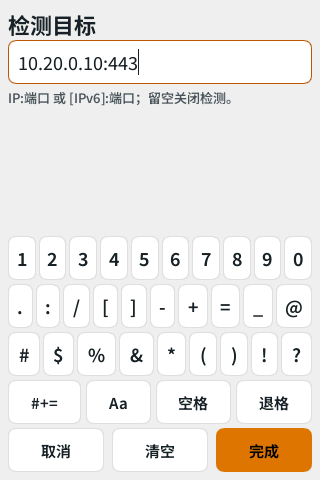

# 实时状态与 Tailscale 网络验证

日期：2026-11-03。设备：ZTE U60 Pro / MU5250，固件 B31。本记录补充同日的[显示与锁屏验证](validation-2026-11-03.md)。

## 功能范围

- 机身默认通过本机 agent 的正常认证连接 HTTP/SSE，读取信号、流量、电量、设备数量和 Tailscale 状态。桌面默认演示；通过 loopback 隧道连接时需登录。
- 将 UI、目录标识与文档统一为 Tailscale 网络、子网路由、子网路由器、热点转发、连通性检测。旧页面、脚本及备份路径作为兼容入口保留。
- 检测目标由本机配置，默认空；检查实际路由、绑定 `tailscale0` 的 TCP 连接和本项目的转发/NAT 规则，分别呈现结果，60 秒过期。源代码和本记录不包含实际目标地址。
- 检测目标、后台密码、HEX 配色共用触屏 ASCII 编辑器；熄屏/锁屏清空未提交输入。尚不支持设备上的中文输入法。
- 其他尚未接入的业务页面隐藏原型读数和动作，明确提示当前不可操作。

## 验证结果

| 检查 | 结果与范围 |
| --- | --- |
| 原生 Rust | 14 项通过，包括既有屏幕/锁屏回归，HTTP 认证和重定向限制、SSE 分帧、数据单位/陈旧读数、休眠关闭连接、路由与规则解析、旧检测结果隔离，以及实际指针点击软键盘、编辑校验、光标退格和锁屏清空输入 |
| 原生 Clippy | `--all-targets --all-features -- -D warnings` 通过 |
| 格式与目录 | 原生 `cargo fmt --check`、`git diff --check`、共享功能目录一致性通过，13 个分类 / 79 个入口 |
| 浏览器原型 | 命名整理后的全部入口、表单/场景与配色回归通过，无脚本错误及外部请求 |
| 网关脚本 | 4 项 Python 回归通过：OTA 布局拒绝写入、多子网与非 /24 LAN、重复应用、旧规则迁移、无效或重叠网段拒绝及无关规则保留 |
| agent | 12 项 Tailscale 测试通过；ARM64 musl release 构建成功。上游已有的 18 项编译告警保留 |
| 设备认证 | 最终 ARM 程序从已有本机 agent 登录，成功收到信号、流量、电量，不输出凭证或原始数据 |
| 设备连通性 | 用户指定目标经 `tailscale0`，TCP 连接成功；当前 LAN 与已有转发、回程、NAT 规则匹配。未修改网络、防火墙或 agent 安装 |
| 机身界面 | 最终程序通过 DRM 首帧提交，完成 120 秒限时试运行；用户确认显示和触屏输入正常；日志确认原厂 UI 与背光已恢复，无残留试运行 |

上述连接检测由 U60 发起，不能代替热点客户端的端到端访问验证。软键盘已通过渲染、指针事件及用户实机验证。IPv6 输入和路径选择有代码支持，未在此设备实测 IPv6 远端目标。

## 发布构建测量

| 产物 | stripped ELF 字节 | `size -A` Total | gzip level 9 / mtime 0 |
| --- | ---: | ---: | ---: |
| u60-screen | 8,263,640 | 8,235,705 | 4,627,501 |
| zte-agent | 6,886,360 | 6,878,028 | 3,323,286 |

u60-screen SHA-256：`377893926feebfd56a2b20748b752f819eee0bac6dde9dbd398e60a1f621399a`。

zte-agent SHA-256：`2f717ce39966b240a79618d5d999d2deaf9314e7186cefca0f4895c72df18f72`。此 agent 构建用于验证新旧网关脚本路径兼容，未部署到设备。

程序二进制、设备偏好、会话文件、原始日志和个人网络信息不加入 Git。
