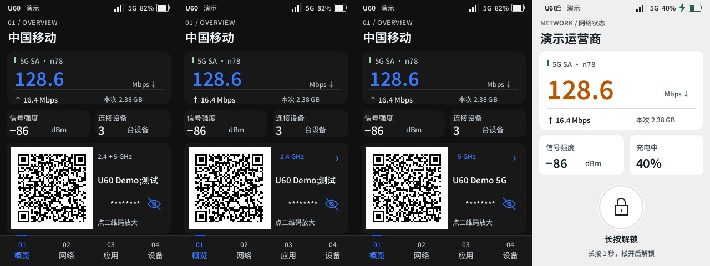
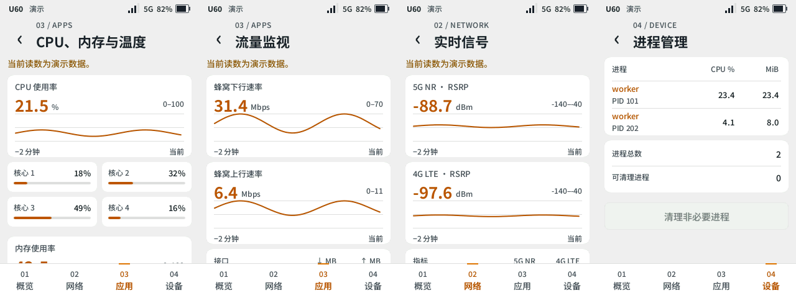

# 屏幕布局与数据展示盘点

2026-11-04，基于 320×480 原生 Slint 界面和全部 82 个功能入口。本轮统一状态栏、连接码、解锁交互和读数排版，并给需要连续观察的指标增加趋势。

## 首页与锁屏

- 运营商名称由同一处处理：已识别的中国移动、联通、电信、广电品牌随简体、繁体、英语、日语、韩语切换；未知品牌保留网络提供的名称。首页、锁屏、信号详情、SIM 信息共用此规则。
- 状态图标按实际内容宽度靠右排列。充电、直供电、网络制式和电量文字宽度变化时，整个图标组重新贴齐右侧。
- 首页二维码保留固定 148×148 区域，名称在独立列中换行。双频名称不同仍分别提供连接码；两码采用相同的二维码版本，切换时图形占用尺寸一致。名称和安全设置相同的双频继续共用一个连接码。
- 解锁改为独立圆形锁图标，按住时显示环形进度，满 1 秒后松开解锁。移出、取消与可选密码流程延续已有行为。



## 已落地的数据视图

| 页面 | 展示方式 | 操作与数据含义 |
| --- | --- | --- |
| CPU、内存与温度 | CPU、内存占用、最高温度趋势；各核心使用条；容量与传感器明细表 | 内存与温度保留各自来源和单位 |
| 流量监视 | 上下行 Mbps 趋势；接口收发累计量对照表 | 累计量使用 MB，与实时速率分别显示 |
| 实时信号 | NR / LTE RSRP 趋势；两种制式并列的信号指标表 | 无服务与无效值显示空缺；信道和 PCI 保留 |
| 电池详情 | 电量、温度、电流趋势；供电状态和电压明细表 | 电流保留正负号；直供电操作保留确认 |
| 连接设备 | 设备名称、下载速率、上传速率对照表 | 副行展示地址和频段；点击进入详情 |
| 进程管理 | 进程、CPU、内存对照表 | 副行显示 PID，同名进程按 PID 独立选择 |
| 载波聚合 | 频段、PCI、带宽对照表 | 副行显示信道；点击查看主辅载波等信息 |
| 邻区扫描 | 频段、PCI、RSRP 对照表 | 副行显示信道，保留主动扫描 |
| 流量与套餐 | 今日、本月、累计的上下行 GB 对照表 | 套餐额度与结算周期沿用原表单 |
| 短信存储 | 设备与 SIM 占用条；实际容量明细表 | 缺失或不合理的容量显示未知 |



普通状态字段改为有分隔线的紧凑键值表，长值可换行。列表中的点击区域至少 44 px，数值右对齐；正文和操作表单保持适合阅读、编辑的结构。辅助文字至少 12 px，使用现有字形 hinting 和主题配色。

## 趋势与刷新约束

- 趋势只保存本次页面观察的最近 2 分钟，每条最多 61 个点，常规订阅观察最多每 2 秒记录一次。内存等慢接口只在其真实读取完成时记录。
- 复用现有 SSE 与读取周期。离开、锁屏、熄屏及编辑期间遵守原有暂停策略；打开另一功能页会重置该页趋势缓冲。趋势存于内存。
- 缺失、失败或超出有效范围的读数留空；中断与过大的采样间隔断开曲线。百分比有 0–100 固定标尺，网速等指标按最近样本扩展范围；坐标范围随图显示。
- 当前数值与曲线分别使用稳定模型，读数变化只通知对应部分。图形时间轴只在采样时前进，避免每个界面 tick 都让所有图表移动。
- 表格按记录标识增量更新。列表前方增删记录时，尽量保留当前可见记录的位置；进入详情仍使用原记录标识。
- 首个有效样本显示「正在积累趋势」；演示模式明确标注，使用独立的合成时间序列。

具体读取周期和手动刷新策略见 [逐页刷新盘点](refresh-policy.md)。

## 全部入口复盘

| 功能组 | 入口数 | 本轮处理与后续判断 |
| --- | ---: | --- |
| Wi-Fi 与局域网 | 6 | 固定连接码布局；设备速率对照表；设置仍用表单 |
| 移动网络 | 7 | 流量用量对照表；网络选择与 APN 保持选择、编辑流程 |
| 信号与锁频 | 9 | 信号趋势、制式对照、载波与邻区表；锁频参数用表单 |
| 路由与防火墙 | 10 | 接口状态用键值表；规则保持列表与编辑器 |
| DNS 与隐私 | 3 | 状态用键值表；缓存保留按需读取 |
| VPN 与组网 | 1 | 配置与状态使用键值表及原有操作 |
| Tailscale | 4 | 状态与连通性详情用键值表，检测与版本任务保持各自流程 |
| 代理服务 | 2 | 服务读数用键值表，配置与组选择保持各自流程 |
| 短信 | 5 | 存储占用条；列表、正文、转发规则适合原有阅读和编辑交互 |
| SIM 与 eSIM | 8 | 状态用键值表，卡片与套餐用清单，敏感变更保持确认 |
| 通话与卡片服务 | 3 | 状态用键值表，拨号、USSD 与卡片菜单保持专用交互 |
| 诊断工具 | 7 | 资源与流量趋势、进程表；测速、终端和历史分别评估如下 |
| 自动化 | 2 | 计划和实时活动保持记录与设置结构 |
| 电池与电源 | 6 | 电池趋势；充电、休眠和 USB 设置仍用表单 |
| 系统设置 | 9 | 设备信息用键值表；外观、连接、恢复与升级保持专用交互 |
| 合计 | 82 | 每组均核对，按数据性质选择展示方式 |

## 后续适合继续改进的页面

| 页面 | 适合的展示 | 数据与交互要求 |
| --- | --- | --- |
| 信号质量检测 | 检测进度条、按小区分组的测量结果 | 扫描结果与连续测量区分；多个小区避免连成同一曲线 |
| 互联网测速 | 阶段进度、延迟与抖动指标卡、下载和上传曲线 | 按一次测试划分记录；下载与上传阶段分别采样 |
| 连接记录、短信转发记录 | 时间线与结果标识 | 保留完整事件、错误信息和详情入口 |
| DNS 缓存 | 域名、记录类型、剩余 TTL 表格 | 仅按需读取；长域名需详情入口 |

这些页面本轮使用紧凑状态表或原有记录列表，上述专用可视化尚未实现。当前接口能提供的状态、控制和详情入口继续保留。

## 验证与预览

68 项 Rust 回归与 7 项恢复脚本回归通过；覆盖全部入口、五种语言、深浅主题、同名记录选择、表格滚动锚点、采样上限与断档、锁屏和密码流程。严格 Clippy、格式、翻译和目录检查通过。

使用与机身相同的 RGB565 持久缓冲区验证：相同短信批次重绘 0 像素；单条短信变化重绘 10,094 像素；单个信号值变化重绘 7,096 像素。整屏为 153,600 像素。实际更新区域随内容与布局变化；曲线到达下一个采样点时会更新绘图区。

ARM64 静态产物为 32,315,432 字节，gzip 为 18,220,154 字节，ELF section Total 为 32,307,121 字节。已通过 ADB 在设备独立临时目录运行：版本输出、真实后台认证与信号／流量／电池订阅读取、资源页离屏 RGB565 渲染均成功；测试文件随后清除。此检查未接管物理屏幕，本轮的机身目视和触摸验收仍待部署后完成。

```bash
bash u60-screen/native.sh snapshot /tmp/u60-resources.png --page resources --light
bash u60-screen/native.sh snapshot /tmp/u60-traffic.png --page traffic --language en --dark
bash u60-screen/native.sh snapshot /tmp/u60-lock.png --page lock --light
```

本文图片由原生程序合成数据生成，无真实热点凭据或设备记录。浏览器早期原型保留在 `preview/`；本轮界面以原生 Slint 截图为准。
